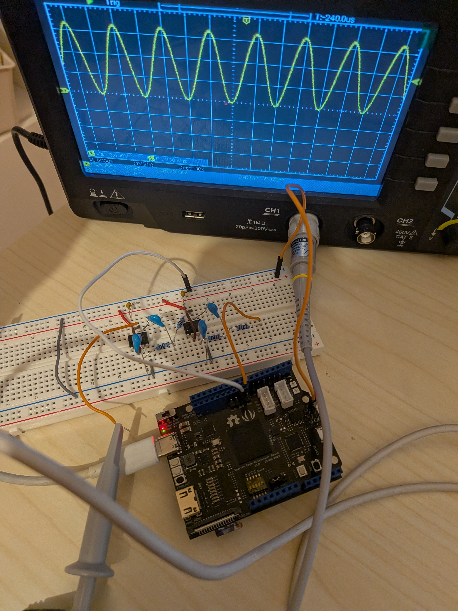
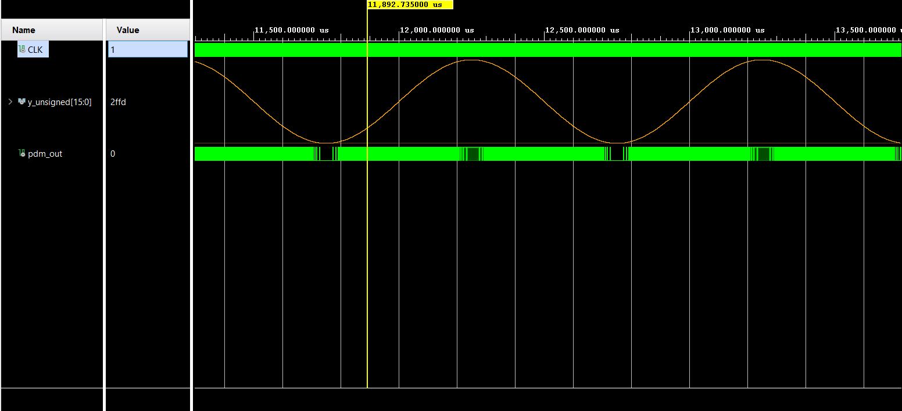

# CORDIC 1st-Order Delta-Sigma Sine Generator (FPGA)

A minimal VHDL implementation of a **LUT-less sine wave generator** combining an iterative **CORDIC** core with a **first-order Delta-Sigma (ΣΔ) DAC** on a Xilinx Spartan-7 FPGA (`xc7s15ftgb196-1`, Spartan Edge Accelerator Board).

Instead of storing waveform samples in a sine lookup table (ROM), the design computes sin(θ) on the fly via shift-and-add CORDIC rotations and converts the 16-bit samples into a 1-bit Pulse-Density Modulated (`pdm_out`) bitstream for external analog low-pass reconstruction.

## Hardware Setup & Results

The FPGA generates a **1 kHz** sine wave at `FPGA_IO0` (pin `N14`). Passing `pdm_out` through a breadboard active low-pass reconstruction filter yields a clean analog sine wave on the oscilloscope (`~1.000 kHz`, `3.40 V` peak-to-peak):

Behavioral simulation in Vivado confirms smooth digital sine synthesis (`y_unsigned[15:0]`) and corresponding pulse-density modulation on `pdm_out`:

## Architecture Overview

| Parameter | Value | Description |
| :--- | :--- | :--- |
| System Clock (`CLK`) | `100 MHz` | Pin `H4` (`LVCMOS33`) |
| Phase Accumulator | 32-bit | `phase_inc = 687195` (~1 kHz output) |
| CORDIC Update Rate | `6.25 MHz` | 15 shift-add iterations + 1 latch/init cycle (16 clocks) |
| Gain Compensation (`k`) | `0x4DB6` (`19894`) | Pre-scaled 1/K ≈ 0.60712 (with margin to prevent 16-bit overflow) |
| ΔΣ Modulator Rate | `12.5 MHz` | 17-bit error accumulator updated every 8 clock cycles (2 PDM steps/sample) |
| Output (`pdm_out`) | 1-bit PDM | Pin `N14` (`FPGA_IO0`, `SLOW` slew, `4 mA` drive) |
| Interrupt (`interrupt`) | `500 kHz` | Pin `E11` (`FPGA_IO9`, 200-clock periodic pulse, 50% duty) to trigger external ADC sampling |

1. **Phase Generation**: A 32-bit accumulator (`phase_acc`) increments by `phase_inc` every 16 clock cycles (`f_out = phase_inc / 2^32 × 100 MHz / 16 ≈ 1 kHz`).
2. **Quadrant & CORDIC Rotation**: Bits `31:30` select the starting quadrant `(x, y)` with magnitude `k`; bits `29:14` supply the intra-quadrant angle `theta` in Binary Angular Measurement (BAM). Fifteen arithmetic shift-and-add steps (`shift_right`) rotate 17-bit signed `(x, y)` toward zero residual angle using a small 15-entry `atan(2^-i)` constant table (`arctg_lut`).
3. **1st-Order ΔΣ DAC**: Signed `y_out` is shifted to unsigned 16-bit (`y_unsigned = y_out(15:0) + 32767`) and accumulated in a 17-bit register (`sigma_acc`) every 8 clock cycles (exactly 2 PDM steps per CORDIC sample). The carry bit `sigma_acc(16)` drives `pdm_out`.
4. **ADC Sampling Trigger (`interrupt`)**: Generates a 500 kHz periodic pulse (100 cycles high, 100 cycles low) used to trigger the external ADC for sampling the reconstructed waveform.

## Repository Contents

- `src/SIGMA_DELTA_CORDIC.vhd`: Main VHDL entity (`sigma_Delta`) implementing the CORDIC sine generator and 1st-order ΔΣ DAC.
- `sim/tester.vhd`: Minimal VHDL testbench (`tb_sigma_Delta`).
- `constraints/constraints.xdc`: Pinout and 100 MHz clock constraints for `xc7s15ftgb196-1`.
- `CORDIC.m`: MATLAB script used to verify the CORDIC algorithm, scaling constant `k`, `atan` constants, and `phase_inc`.
- `images/`: Vivado waveform screenshot and hardware setup photo.
- `LICENSE`: MIT License.

## Running in Vivado

1. Create a new Vivado RTL project targeting `xc7s15ftgb196-1` and add `src/SIGMA_DELTA_CORDIC.vhd`, `sim/tester.vhd`, and `constraints/constraints.xdc`.
2. Run **Behavioral Simulation** (`tb_sigma_Delta`) to inspect `y_unsigned` (set radix to Unsigned and waveform style to Analog) and `pdm_out`.
3. Run **Synthesis**, **Implementation**, and **Generate Bitstream** to program the FPGA.

## Notes

This project is a proof of concept for LUT-less CORDIC + 1st-order ΣΔ sine synthesis. Minor imperfections, such as 1st-order quantization noise, are left as-is since the reconstructed 1 kHz sine wave meets the main goal. Measured output achieved an ENOB of about 7 bits, limited mainly by the FPGA GPIO pin (unbalanced pull-up and pull-down) and breadboard and jumper-wire parasitics.

## License

Released under the [MIT License](LICENSE).
